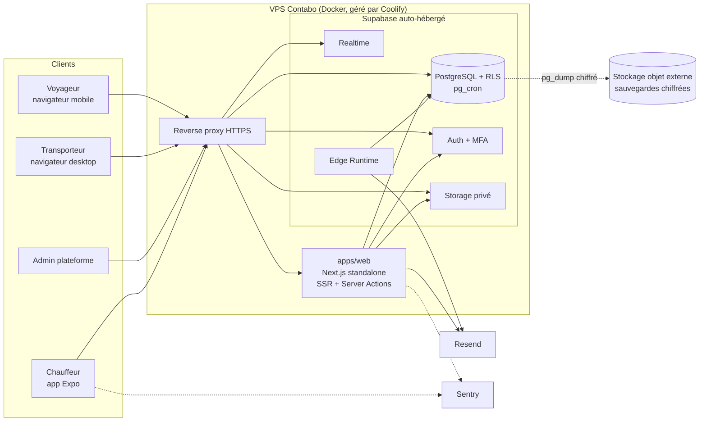
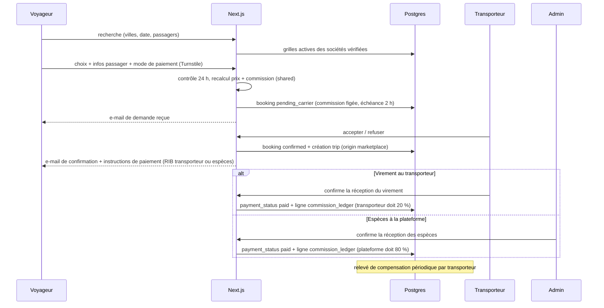

# Architecture

## 1. Vue d'ensemble

Principe : **un seul serveur (VPS Contabo)** qui héberge Supabase auto-hébergé et l'application web, une seule application web pour les trois espaces (marketplace publique, SaaS, admin) via des groupes de routes, une application mobile pour les chauffeurs. Pas de serveur applicatif séparé. Voir ADR-013.

## 2. Monorepo

| Paquet | Rôle | Consommé par |
|---|---|---|
| `apps/web` | Marketplace, SaaS, admin, webhooks | VPS (Docker) |
| `apps/driver` | App chauffeur Expo | EAS |
| `packages/shared` | Schémas Zod, constantes métier, calculs purs, machines à états, matrice de permissions | web, driver, edge functions |
| `packages/db` | Types générés Supabase, helpers de requêtes typés | web, driver |
| `packages/ui` | Tokens de design (couleurs, typo, espacements, rayons) exportés en CSS variables et en objet TS | web, driver, e-mails, PDF |
| `packages/payments` | Interface `PaymentProvider` (adaptateur `mock`, carte en ligne reportée) et types des modes hors ligne | web |

Règle de dépendance : `apps/*` dépendent de `packages/*` ; `packages/shared` ne dépend d'aucun autre paquet interne ; aucune dépendance d'un paquet vers une app.

## 3. Organisation de `apps/web`

- `src/app/[locale]/(public)` : accueil, recherche, résultats, tunnel de réservation, gestion de réservation, pages légales, pages villes / axes (SEO).
- `src/app/[locale]/(auth)` : connexion, inscription transporteur, mot de passe, MFA.
- `src/app/[locale]/(saas)/app` : espace transporteur (layout avec barre latérale, sélecteur de société si multi-appartenance).
- `src/app/[locale]/(admin)/admin` : back-office (MFA exigé par le layout et par RLS via `aal2`).
- `src/app/api` : route handlers (healthcheck pour la supervision, futurs webhooks de paiement en ligne).
- `src/features/<domaine>` : `components/`, `actions.ts` (Server Actions), `queries.ts`, `schemas.ts` (réexport depuis shared).
- `src/lib` : clients Supabase (`server`, `browser`, `admin` service_role serveur uniquement), `auth.ts` (session, rôle, société courante), `permissions.ts`, `rate-limit.ts`, `feature-gate.ts`.

## 4. Flux principaux

### 4.1 Réservation marketplace (paiement hors ligne, ADR-012)

### 4.2 Localisation chauffeur (V2)

App chauffeur : démarrage du trajet (statut `in_progress`) puis envoi des positions dans `driver_locations` (insert autorisé par RLS seulement si le trajet du chauffeur est `in_progress`) ; le gestionnaire s'abonne au canal Realtime filtré par `company_id`. Fin du trajet : arrêt de la tâche de fond. Purge par pg_cron.

### 4.3 Feature gating

`plan_features(plan_code, feature_key)` ; fonction SQL `has_feature(company_id, key)` utilisée par les politiques RLS des tables V2/V3 ; helper serveur `hasFeature()` et composant `<FeatureGate>` pour l'UI.

## 5. Versions relevées (npm, 2026-10-24)

À figer en Phase 1 après vérification de compatibilité croisée (voir ADR-009).

| Paquet | Dernière stable |
|---|---|
| node (local) | 24.22.1 |
| pnpm | 12.15.0 (non installé localement) |
| turbo | 2.11.10 |
| next | 16.4.3 |
| react | 19.3.1 |
| typescript | 7.0.2 (compatibilité à valider) |
| tailwindcss | 4.3.3 |
| next-intl | 4.14.9 |
| @supabase/supabase-js | 2.118.0 |
| @supabase/ssr | 0.12.7 |
| supabase (CLI) | 2.122.0 (non installé localement) |
| zod | 4.6.7 |
| react-hook-form | 7.91.0 |
| @tanstack/react-query | 5.104.5 |
| expo | 58.0.19 |
| expo-router | 58.0.26 |
| i18next | 26.5.10 |
| resend | 6.34.1 |
| @react-pdf/renderer | 4.9.0 |
| maplibre-gl | 6.15.0 |
| vitest | 5.0.5 |
| @playwright/test | 1.64.1 |

Outils locaux constatés : Node 24, git 2.56, Docker 29.8 (requis pour `supabase start`).

## 6. Environnements

| Environnement | Web | Backend | Données |
|---|---|---|---|
| local | `pnpm dev` | `supabase start` (Docker) | `seed.sql` fictif |
| staging | conteneur sur le VPS (sous-domaine) | Supabase auto-hébergé staging | fictives |
| production | conteneur sur le VPS | Supabase auto-hébergé production | réelles |

Jamais de données réelles en local. Migrations appliquées par `supabase db push` (via l'URL Postgres du VPS, par tunnel SSH) sur staging puis production, jamais de modification manuelle du schéma.
