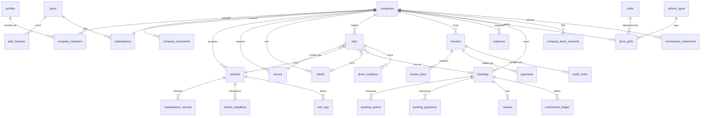

# Modèle de données

> **Statut** : identité, sociétés, référentiels et paramètres **implémentés** (étape 4) ; le reste décrit la cible et sera mis à jour à chaque migration.

Conventions : clés primaires `uuid` (`gen_random_uuid()`), `created_at` / `updated_at` `timestamptz` (UTC), montants `bigint` en centimes suffixés `_cents`, taux `numeric(5,4)`, énumérations en types Postgres `enum` ou `text` + `check`. **RLS activée sur toutes les tables**, aucune politique permissive par défaut.

## 1. Diagramme ER (simplifié)

## 2. Tables par domaine

### Identité et organisation (Phase 1)

| Table | Colonnes clés | Notes RLS |
|---|---|---|
| `profiles` | `id` (= auth.users.id), `full_name`, `phone`, `locale`, `is_platform_admin` | Lecture / écriture de son propre profil ; admin lit tout. `is_platform_admin` non modifiable par l'utilisateur |
| `companies` | `legal_name`, `trade_name`, `ice`, `if_number`, `rc_number`, `tp_number`, `license_number`, `license_expires_on`, `city_id`, `address`, `logo_path`, `status` (`pending|verified|suspended`), `marketplace_enabled`, `commission_rate` nullable, `default_vat_rate` | Membres actifs lisent ; owner/manager modifient (sauf `status`, `commission_rate` : admin uniquement). Vue publique restreinte pour la marketplace |
| `company_members` | `company_id`, `user_id`, `role` (`owner|manager|dispatcher|accountant|driver`), `is_active` | Membres lisent les membres de leur société ; owner gère |
| `company_documents` | `company_id`, `type`, `storage_path`, `verification_status`, `expires_on` | Owner/manager + admin |
| `company_bank_accounts` | `company_id`, `bank_name`, `rib` (24 chiffres), `holder_name`, `is_default` | Owner/accountant + admin ; RIB communiqué au voyageur seulement pour une réservation confirmée, via Server Action (ADR-016) |

Fonctions SQL de sécurité, schéma `private` (`security definer`, `search_path` vide, non exposé en RPC) : `is_member(company_id)`, `has_role(company_id, roles[])`, `is_platform_admin()` (exige `aal2`), `shares_company(user_id)` ; `has_feature(company_id, key)` en Phase 2.

Implémentation (étape 4) :
- Colonnes réservées à l'admin, protégées par triggers de garde : `companies.status`, `companies.marketplace_enabled`, `companies.commission_rate` ; `company_documents.verification_status`, `reviewed_by`, `reviewed_at`, `rejection_reason` ; `profiles.is_platform_admin` (modifiable seulement en accès direct à la base).
- `public.create_company(legal_name, trade_name, city_id)` : seule façon de créer une société (statut `pending`, appelant propriétaire).
- Trigger `on_auth_user_created` : crée le profil à l'inscription (nom et langue depuis les métadonnées).
- Trigger `keep_one_owner` : impossible de retirer ou rétrograder le dernier propriétaire actif.
- `companies.ice` : 15 chiffres ; `company_documents.storage_path` doit commencer par `{company_id}/`.
- Accès anonyme révoqué sur les tables de tenant.

### Abonnements (Phase 2)

`plans` (`code`, `monthly_price_cents` nullable), `plan_features` (`plan_code`, `feature_key`), `subscriptions` (`company_id`, `plan_code`, `status` `trial|active|past_due|cancelled`, `current_period_start/end`, `payment_method`), `subscription_invoices`.

### Référentiels (Phase 1 / 3)

`cities` (`slug`, `name_fr`, `name_en`, `name_ar`, `region`, `latitude`, `longitude`, `is_airport`, `iata_code`, `served_city_id` pour rattacher un aéroport à sa ville, `is_active`) : 6 villes + 6 aéroports (CMN, RAK, FEZ, AGA, TNG, RBA), coordonnées approximatives. `vehicle_types` (`code`, libellés fr / en / ar, `indicative_seats`, `sort_order`) : sedan, suv_4x4, van, minibus, coach. Lecture publique, écriture admin (MFA).

### SaaS Standard (Phase 2)

`vehicles`, `drivers`, `clients`, `trips`, `invoices`, `invoice_lines`, `credit_notes`, `invoice_sequences` (`company_id`, `year`, `last_number`, verrouillage `for update` pour la numérotation sans trou), `payments`. Toutes portent `company_id` ; politiques par rôle selon la matrice de [SECURITY.md](SECURITY.md). Factures `issued` : trigger interdisant `update` des champs financiers et tout `delete`.

### SaaS V2 (Phase 4)

`expenses` (justificatif dans bucket privé `receipts/{company_id}/...`), `driver_locations` (insert uniquement par le chauffeur affecté quand `trips.status = 'in_progress'` ; purge pg_cron après `platform_settings.location_retention_days`).

### SaaS V3 (Phase 5)

`maintenance_records`, `vehicle_deadlines` (rappels J-30/J-7/J-1 via edge function planifiée), `fuel_logs`.

### Marketplace (Phase 3)

`price_grids`, `bookings` (`public_ref` unique, `traveler_id` nullable, `traveler_email`, `traveler_phone`, `total_cents`, `commission_rate`, `commission_cents`, `carrier_cents`, `cancellation_policy` figée, `status`, `payment_method` `bank_transfer | cash_to_driver | online_card`, `payment_status` `unpaid | paid | partially_refunded | refunded`, `accept_deadline`), `booking_events`, `booking_payments` (`booking_id`, `method`, `amount_cents`, `declared_by` (chauffeur ou membre), `confirmed_by`, `confirmed_at`, `reference`, justificatif facultatif ; mouvements négatifs pour les remboursements), `commission_ledger` (`booking_id`, `company_id`, `direction` `carrier_owes_platform | platform_owes_carrier`, `amount_cents`, `statement_id` nullable), `commission_statements` (`company_id`, mois, `total_due_cents`, statut `draft | issued | paid | overdue`, `due_date`), `commission_statement_payments` (`statement_id`, `method` `cash | instant_transfer | bank_transfer`, `amount_cents`, `received_at`, `reference`, `recorded_by` admin), `reviews`. Table `payment_transactions` (carte en ligne) reportée. Voir ADR-016.

Accès invité : jamais d'accès direct anonyme à `bookings` ; la consultation par référence + e-mail passe par une Server Action qui vérifie un jeton de lien magique signé et à durée limitée.

### Transverse

`notifications`, `audit_logs` (Phase 2 : insert via triggers / service, lecture admin et owner pour sa société), `platform_settings` (implémentée : clé / valeur JSON validée par Zod dans `@mtr/shared` : `default_commission_bps`, `min_booking_lead_hours`, `carrier_accept_hours`, `cancellation_policy`, `statement_suspension_days`, `location_retention_days`, `saas_trial`, `marketplace_open` ; lecture publique, modification admin, clés créées par migration uniquement).

## 3. Migrations

| Fichier | Contenu | Phase |
|---|---|---|
| `20261025210000_reference_data.sql` | `cities` (villes + aéroports), `vehicle_types`, lecture publique | 1 (étape 4) |
| `20261025210100_identity_and_companies.sql` | schéma `private`, énumérations, `profiles`, `companies`, `company_members`, `company_documents`, fonctions de sécurité, triggers de garde, `create_company`, RLS | 1 (étape 4) |
| `20261025210200_platform_settings.sql` | `platform_settings` + valeurs par défaut | 1 (étape 4) |

Tests pgTAP : `supabase/tests/database/*.test.sql` (42 assertions). Types : `pnpm db:types` vers `packages/db/src/types.ts` (vérifié en CI).
