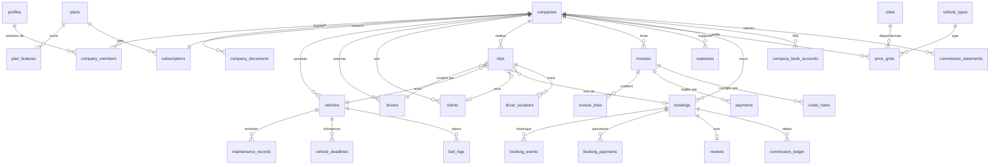

# Modèle de données

> **Statut** : identité, sociétés, référentiels et paramètres **implémentés** (étape 4) ; le reste décrit la cible et sera mis à jour à chaque migration.

Conventions : clés primaires `uuid` (`gen_random_uuid()`), `created_at` / `updated_at` `timestamptz` (UTC), montants `bigint` en centimes suffixés `_cents`, taux `numeric(5,4)`, énumérations en types Postgres `enum` ou `text` + `check`. **RLS activée sur toutes les tables**, aucune politique permissive par défaut.

## 1. Diagramme ER (simplifié)

## 2. Tables par domaine

### Identité et organisation (Phase 1)

| Table | Colonnes clés | Notes RLS |
|---|---|---|
| `profiles` | `id` (= auth.users.id), `full_name`, `phone`, `locale`, `is_platform_admin` | Lecture / écriture de son propre profil ; admin lit tout. `is_platform_admin` non modifiable par l'utilisateur |
| `companies` | `legal_name`, `trade_name`, `ice`, `if_number`, `rc_number`, `tp_number`, `license_number`, `license_expires_on`, `city_id`, `address`, `logo_path`, `status` (`pending|verified|suspended`), `marketplace_enabled`, `commission_rate` nullable, `default_vat_rate` | Membres actifs lisent ; owner/manager modifient (sauf `status`, `commission_rate` : admin uniquement). Vue publique restreinte pour la marketplace |
| `company_members` | `company_id`, `user_id`, `role` (`owner|manager|dispatcher|accountant|driver`), `is_active` | Membres lisent les membres de leur société ; owner gère |
| `company_documents` | `company_id`, `type`, `storage_path`, `verification_status`, `expires_on` | Owner/manager + admin |
| `company_bank_accounts` | `company_id`, `bank_name`, `rib` (24 chiffres), `holder_name`, `is_default` | Owner/accountant + admin ; RIB communiqué au voyageur seulement pour une réservation confirmée, via Server Action (ADR-016) |

Fonctions SQL de sécurité, schéma `private` (`security definer`, `search_path` vide, non exposé en RPC) : `is_member(company_id)`, `has_role(company_id, roles[])`, `is_platform_admin()` (exige `aal2`), `shares_company(user_id)` ; `has_feature(company_id, key)` en Phase 2.

Implémentation (étape 4) :
- Colonnes réservées à l'admin, protégées par triggers de garde : `companies.status`, `companies.commission_rate`, `companies.marketplace_suspended_at`, `companies.marketplace_suspension_reason` (`marketplace_enabled` est modifiable par propriétaire et gérant, Q19) ; `company_documents.verification_status`, `reviewed_by`, `reviewed_at`, `rejection_reason` ; `profiles.is_platform_admin` (modifiable seulement en accès direct à la base).
- `public.create_company(legal_name, trade_name, city_id)` : seule façon de créer une société (statut `pending`, appelant propriétaire).
- Trigger `on_auth_user_created` : crée le profil à l'inscription (nom et langue depuis les métadonnées).
- Trigger `keep_one_owner` : impossible de retirer ou rétrograder le dernier propriétaire actif.
- `companies.ice` : 15 chiffres ; `company_documents.storage_path` doit commencer par `{company_id}/`.
- Accès anonyme révoqué sur les tables de tenant.

### Abonnements (Phase 2)

**Implémenté (étape 6)** : `plans` (`code`, `monthly_price_cents` nullable = sur devis, `sort_order`), `plan_features` (`plan_code`, `feature_key` : trips, vehicles, drivers, clients, invoicing, payments ; + expenses, driver_app, expense_receipts, live_tracking ; + fleet_maintenance, vehicle_deadlines, fuel_tracking), `subscriptions` (clé `company_id`, `plan_code`, `status` `trial|active|past_due|cancelled`, `trial_ends_at`, `current_period_start/end`, `payment_method`, `notes`), créé par le trigger `companies_start_trial`. Fonction `private.has_feature(company_id, feature)` = **accès en écriture** (ADR-022) ; colonne `past_due_since` (trigger) ; tâche pg_cron `cancel-overdue-subscriptions`. **Convention RLS des tables SaaS** : SELECT = appartenance ; INSERT / UPDATE / DELETE = appartenance + `has_feature`. `subscription_invoices` : plus tard (factures d'abonnement).

### Référentiels (Phase 1 / 3)

`cities` (`slug`, `name_fr`, `name_en`, `name_ar`, `region`, `latitude`, `longitude`, `is_airport`, `iata_code`, `served_city_id` pour rattacher un aéroport à sa ville, `is_active`) : 6 villes + 6 aéroports (CMN, RAK, FEZ, AGA, TNG, RBA), coordonnées approximatives. `vehicle_types` (`code`, libellés fr / en / ar, `indicative_seats`, `sort_order`) : sedan, suv_4x4, van, minibus, coach. Lecture publique, écriture admin (MFA).

### SaaS Standard (Phase 2)

**Implémentés (étape 7)** : `vehicles` (`registration` normalisée et unique par société, `brand`, `model`, `vehicle_type_code`, `seats`, `luggage_capacity`, `year`, `status` `active|maintenance|inactive`), `drivers` (`user_id` facultatif, `full_name`, `phone`, permis et carte professionnelle avec dates d'expiration, `languages`, `status`). **Implémenté (étape 8)** : `clients` (`type` `b2b|b2c`, `name`, `ice` 15 chiffres autorisé seulement en B2B, `email`, `phone`, `address`, `notes`, `is_active`) ; lecture : rôles de bureau, écriture : propriétaire, gérant, dispatcheur avec offre active. Aucune suppression physique dans l'interface : véhicules, chauffeurs et clients sont désactivés. **Implémenté (étape 9)** : `trips` (`origin` `manual|marketplace`, client facultatif, passager principal, passagers, bagages, villes ou aéroports et adresses de départ et d'arrivée, `starts_at` / `ends_at` en UTC, `price_cents`, véhicule et chauffeur facultatifs, `status` `planned|assigned|in_progress|completed|cancelled`, dérogation `conflict_override` + `override_reason` + `override_by`, `cancel_reason`). Clés étrangères composites `(id, company_id)` : un trajet ne peut référencer que le véhicule, le chauffeur ou le client de sa propre société. Trigger `private.check_trip` (machine à états, permis, véhicule actif, capacité, chevauchements, droit de dérogation, verrou consultatif par société) ; pas de politique DELETE. **Implémentés (étape 10)** : `invoices` (brouillon puis `issued`, `partially_paid`, `paid`, `cancelled` ; `number` et `year` attribués à l'émission ; totaux calculés ; `seller` et `buyer` figés en JSON à l'émission), `invoice_lines` (quantité entière, prix unitaire HT en centimes, `vat_rate_bps` choisi par ligne, montants calculés par trigger, `trip_id` facultatif), `credit_notes` (avoir total, série `AV-AAAA-NNNNNN`, un par facture), `payments` (montant, mode, date, référence), `private.document_sequences` (compteurs par société, type et année, écrits uniquement par les fonctions `security definer`). Fonctions `public.issue_invoice` et `public.create_credit_note`. Toutes portent `company_id` ; politiques par rôle selon la matrice de [SECURITY.md](SECURITY.md). Factures `issued` : trigger interdisant `update` des champs financiers et tout `delete`.

### SaaS V2 (Phase 4)

`expenses` (justificatif dans bucket privé `receipts/{company_id}/...`), `driver_locations` (insert uniquement par le chauffeur affecté quand `trips.status = 'in_progress'` ; purge pg_cron après `platform_settings.location_retention_days`).

### SaaS V3 (Phase 5)

`maintenance_records`, `vehicle_deadlines` (rappels J-30/J-7/J-1 via edge function planifiée), `fuel_logs`.

### Marketplace (Phase 3)

**Implémentés (étapes 12 et 13)** : `price_grids` (`company_id`, `from_city_id`, `to_city_id` (villes ou aéroports), `vehicle_type_code`, `price_cents` tout compris, `is_active`, unique par trajet et type ; lecture : membres, écriture : propriétaire et gérant, sans condition d'abonnement SaaS), `private.is_marketplace_eligible` (BR-016), `public.search_offers` (anonyme autorisé). **Implémentés (étapes 14 et 15)** : `bookings` (référence `MTR-XXXXXX`, voyageur invité, lieux et adresses, `pickup_at`, prix, taux, commission et part transporteur **figés**, politique d'annulation figée, `payment_method`, `status`, `payment_status`, `accept_deadline`, `trip_id`, `refund_cents`), `booking_events` (historique), `commission_ledger` (commission due par trajet terminé ou sur la part retenue d'une annulation payée), `email_outbox` (rôle service seulement), colonnes `companies.bank_name` / `bank_rib`, `trips.booking_id`. Fonctions : `create_booking`, `cancel_booking_by_traveler`, `booking_notification_recipients` (rôle service seulement), `respond_booking`, `confirm_booking_payment`, `confirm_booking_refund` (rôles transporteur), `private.expire_pending_bookings` (pg_cron toutes les 5 minutes), trigger `private.sync_booking_from_trip`. **Implémentés (étape 16)** : `commission_statements` (un relevé par transporteur et par mois, `total_cents`, `paid_cents`, `status` `issued|paid|overdue`, `due_date`), `commission_statement_payments` (espèces, virement instantané, virement ; enregistrés par l'admin), `commission_ledger.statement_id`. Fonctions : `public.generate_commission_statements` et `public.record_statement_payment` (admin avec MFA), `private.generate_commission_statements` (pg_cron le 1er du mois), `private.process_overdue_statements` (pg_cron quotidien : retard puis suspension marketplace). Description d'origine : (`public_ref` unique, `traveler_id` nullable, `traveler_email`, `traveler_phone`, `total_cents`, `commission_rate`, `commission_cents`, `carrier_cents`, `cancellation_policy` figée, `status`, `payment_method` `bank_transfer | cash_to_driver | online_card`, `payment_status` `unpaid | paid | partially_refunded | refunded`, `accept_deadline`), `booking_events`, `booking_payments` (`booking_id`, `method`, `amount_cents`, `declared_by` (chauffeur ou membre), `confirmed_by`, `confirmed_at`, `reference`, justificatif facultatif ; mouvements négatifs pour les remboursements), `commission_ledger` (`booking_id`, `company_id`, `direction` `carrier_owes_platform | platform_owes_carrier`, `amount_cents`, `statement_id` nullable), `commission_statements` (`company_id`, mois, `total_due_cents`, statut `draft | issued | paid | overdue`, `due_date`), `commission_statement_payments` (`statement_id`, `method` `cash | instant_transfer | bank_transfer`, `amount_cents`, `received_at`, `reference`, `recorded_by` admin), `reviews`. Table `payment_transactions` (carte en ligne) reportée. Voir ADR-016.

Accès invité : jamais d'accès direct anonyme à `bookings` ; la consultation par référence + e-mail passe par une Server Action qui vérifie un jeton de lien magique signé et à durée limitée.

### Transverse

`notifications`, `audit_logs` (**implémentée**, étape 6 : ajout seul par triggers `private.audit_changes`, colonnes modifiées uniquement, lecture admin et propriétaire), `platform_settings` (implémentée : clé / valeur JSON validée par Zod dans `@mtr/shared` : `default_commission_bps`, `min_booking_lead_hours`, `carrier_accept_hours`, `cancellation_policy`, `statement_suspension_days`, `location_retention_days`, `saas_trial`, `marketplace_open`, `subscription_grace_days`, `subscription_payment_info` ; lecture publique, modification admin, clés créées par migration uniquement).

## 3. Migrations

| Fichier | Contenu | Phase |
|---|---|---|
| `20261025210000_reference_data.sql` | `cities` (villes + aéroports), `vehicle_types`, lecture publique | 1 (étape 4) |
| `20261025210100_identity_and_companies.sql` | schéma `private`, énumérations, `profiles`, `companies`, `company_members`, `company_documents`, fonctions de sécurité, triggers de garde, `create_company`, RLS | 1 (étape 4) |
| `20261025210200_platform_settings.sql` | `platform_settings` + valeurs par défaut | 1 (étape 4) |
| `20261026090000_marketplace_suspension.sql` | suspension marketplace réservée à l'admin, visibilité gérée par le transporteur (Q19) | 1 (étape 5) |
| `20261026090100_rate_limits.sql` | `private.rate_limits` + `public.consume_rate_limit()` (rôle service uniquement) | 1 (étape 5) |
| `20261026100000_subscriptions.sql` | offres, fonctions par offre, abonnements, essai automatique, `has_feature` | 2 (étape 6) |
| `20261026100100_audit_logs.sql` | journal d'audit et triggers | 2 (étape 6) |
| `20261026100200_audit_ignore_unchanged_nulls.sql` | correctif : colonnes restées vides ignorées à la création | 2 (étape 6) |
| `20261026120000_fleet_drivers_documents.sql` | véhicules, chauffeurs, bucket privé `company-documents` et ses politiques, audit des dépôts | 2 (étape 7) |
| `20261026110000_subscription_access_rules.sql` | lecture seule (Q21), délai de grâce et résiliation planifiée (Q22, pg_cron), coordonnées de paiement (Q23) | 2 (étape 6) |
| `20261027090000_clients.sql` | clients B2B / B2C et leurs politiques | 2 (étape 8) |
| `20261027100000_trips.sql` | trajets, contrôles d'affectation, audit, politiques | 2 (étape 9) |
| `20261027110000_invoicing.sql` | factures, lignes, avoirs, paiements, numérotation sans trou, immutabilité | 2 (étape 10) |
| `20261028090000_price_grids_and_search.sql` | grilles tarifaires, éligibilité marketplace, recherche publique | 3 (étapes 12 et 13) |
| `20261028100000_bookings.sql` | réservations, acceptation, conversion en trajet, expiration, annulation voyageur, registre des commissions, coordonnées bancaires | 3 (étapes 14 et 15) |
| `20261028110000_email_outbox.sql` | file d'envoi des e-mails et purge à 90 jours | 3 (étape 17) |
| `20261028120000_commission_statements.sql` | relevés mensuels de commissions, paiements, retards et suspension | 3 (étape 16) |

Tests pgTAP : `supabase/tests/database/*.test.sql` (182 assertions). Données de démonstration : `supabase/seed.sql` (local uniquement). Types : `pnpm db:types` vers `packages/db/src/types.ts` (vérifié en CI).
