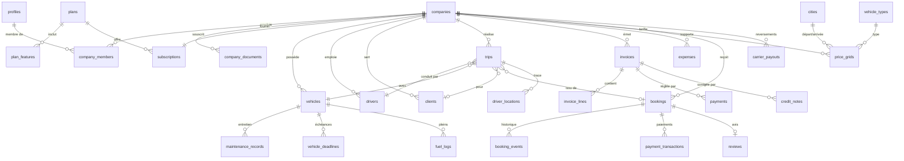

# Modèle de données

> **Statut : conception (Phase 0).** Aucune migration n'existe encore. Ce document décrit la cible ; il sera mis à jour à chaque migration avec le nom du fichier correspondant.

Conventions : clés primaires `uuid` (`gen_random_uuid()`), `created_at` / `updated_at` `timestamptz` (UTC), montants `bigint` en centimes suffixés `_cents`, taux `numeric(5,4)`, énumérations en types Postgres `enum` ou `text` + `check`. **RLS activée sur toutes les tables**, aucune politique permissive par défaut.

## 1. Diagramme ER (simplifié)

## 2. Tables par domaine

### Identité et organisation (Phase 1)

| Table | Colonnes clés | Notes RLS |
|---|---|---|
| `profiles` | `id` (= auth.users.id), `full_name`, `phone`, `locale`, `is_platform_admin` | Lecture / écriture de son propre profil ; admin lit tout. `is_platform_admin` non modifiable par l'utilisateur |
| `companies` | `legal_name`, `trade_name`, `ice`, `if_number`, `rc_number`, `tp_number`, `license_number`, `license_expires_on`, `city_id`, `address`, `logo_path`, `status` (`pending|verified|suspended`), `marketplace_enabled`, `commission_rate` nullable, `default_vat_rate` | Membres actifs lisent ; owner/manager modifient (sauf `status`, `commission_rate` : admin uniquement). Vue publique restreinte pour la marketplace |
| `company_members` | `company_id`, `user_id`, `role` (`owner|manager|dispatcher|accountant|driver`), `is_active` | Membres lisent les membres de leur société ; owner gère |
| `company_documents` | `company_id`, `type`, `storage_path`, `verification_status`, `expires_on` | Owner/manager + admin |

Fonctions SQL de sécurité (`security definer`, `search_path` fixé) : `is_member(company_id)`, `has_role(company_id, roles[])`, `is_platform_admin()` (exige `aal2`), `has_feature(company_id, key)`.

### Abonnements (Phase 2)

`plans` (`code`, `monthly_price_cents` nullable), `plan_features` (`plan_code`, `feature_key`), `subscriptions` (`company_id`, `plan_code`, `status` `trial|active|past_due|cancelled`, `current_period_start/end`, `payment_method`), `subscription_invoices`.

### Référentiels (Phase 1 / 3)

`cities` (`name_fr`, `name_en`, `name_ar`, `region`, `lat`, `lng`, `is_airport`, `slug`), `vehicle_types` (`code`, libellés i18n, `indicative_capacity`). Lecture publique, écriture admin.

### SaaS Standard (Phase 2)

`vehicles`, `drivers`, `clients`, `trips`, `invoices`, `invoice_lines`, `credit_notes`, `invoice_sequences` (`company_id`, `year`, `last_number`, verrouillage `for update` pour la numérotation sans trou), `payments`. Toutes portent `company_id` ; politiques par rôle selon la matrice de [SECURITY.md](SECURITY.md). Factures `issued` : trigger interdisant `update` des champs financiers et tout `delete`.

### SaaS V2 (Phase 4)

`expenses` (justificatif dans bucket privé `receipts/{company_id}/...`), `driver_locations` (insert uniquement par le chauffeur affecté quand `trips.status = 'in_progress'` ; purge pg_cron après `platform_settings.location_retention_days`).

### SaaS V3 (Phase 5)

`maintenance_records`, `vehicle_deadlines` (rappels J-30/J-7/J-1 via edge function planifiée), `fuel_logs`.

### Marketplace (Phase 3)

`price_grids`, `bookings` (`public_ref` unique, `traveler_id` nullable, `traveler_email`, `traveler_phone`, `total_cents`, `commission_rate`, `commission_cents`, `carrier_cents`, `cancellation_policy` figée, `status`, `payment_status`, `accept_deadline`), `booking_events`, `payment_transactions` (`idempotency_key` unique, `provider_ref` unique, payload expurgé), `carrier_payouts`, `commission_ledger`, `reviews`.

Accès invité : jamais d'accès direct anonyme à `bookings` ; la consultation par référence + e-mail passe par une Server Action qui vérifie un jeton de lien magique signé et à durée limitée.

### Transverse

`notifications`, `audit_logs` (insert via triggers / service, lecture admin et owner pour sa société), `platform_settings` (clé / valeur JSON typée par Zod : `default_commission_rate`, `min_booking_lead_hours`, `carrier_accept_hours`, `cancellation_policy`, `location_retention_days`).

## 3. Migrations

| Fichier | Contenu | Phase |
|---|---|---|
| (aucune) | | |
